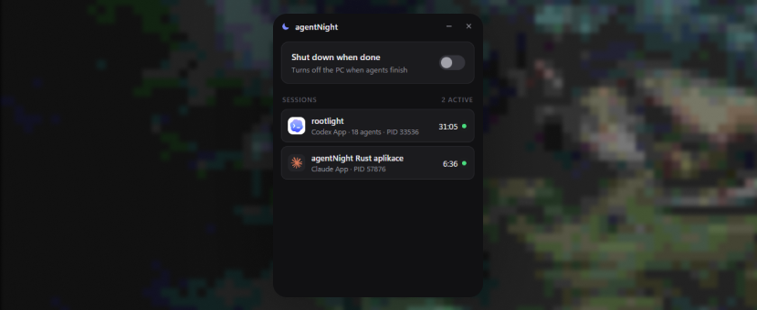

[](https://github.com/tomasmarekk/agentNight/actions/workflows/ci.yml)

[](https://github.com/tomasmarekk/agentNight/blob/main/LICENSE)

Leave your AI coding agents running overnight and let the computer turn itself off when they are done.

agentNight sits in the tray, watches your agent sessions and, once the last one has finished, shuts the computer down.

## Install

Download the latest build from [Releases](https://github.com/tomasmarekk/agentNight/releases/latest).

| Platform | File |
| --- | --- |
| Windows 10/11 | `agentNight_x.y.z_x64-setup.exe` (or `.msi`) |
| macOS 11+ (Apple Silicon and Intel) | `agentNight_x.y.z_universal.dmg` |
| Linux | `.AppImage`, `.deb` or `.rpm` |

The builds are not code-signed yet:

- **Windows**: if SmartScreen appears, choose *More info → Run anyway*.
- **macOS**: after moving the app to Applications, run `xattr -dr com.apple.quarantine /Applications/agentNight.app` once. The first time you arm the switch, macOS asks whether agentNight may control *System Events*. Allow it, otherwise the shutdown cannot happen.
- **Linux**: the tray icon needs AppIndicator support (`libayatana-appindicator3`; on GNOME also the *AppIndicator* extension).

## Use

1. Start your agents as usual.
2. Open agentNight and turn on **Shut down when done**. The switch is only available while at least one agent is working.
3. Close the window (it keeps running in the tray) and go to sleep.

When every session has finished, agentNight waits 5 minutes to make sure nothing picks up again, then shows a 60-second countdown with a **Cancel** button and powers off. Starting new work at any point cancels the countdown.

While the switch is on, agentNight also keeps the computer from going to sleep, so the agents are not paused halfway through.

## Supported agents

| Agent | How it is tracked |
| --- | --- |
| Claude Code: CLI, desktop app, IDE extensions, Agent SDK | Session registry (`busy` / `idle` / `waiting`) plus the transcript |
| Codex: CLI and desktop app | Rollout files: turns, goals, subagents |
| Gemini CLI, Qwen Code, Pi, Factory Droid, GitHub Copilot CLI, Kimi CLI | Session files and process activity |
| opencode, Cursor (editor and CLI), Antigravity, Windsurf, Kiro, Goose, Amp, Cline, Roo Code | Agent storage activity |
| Aider, Crush | Process activity |

Claude Code and Codex are tracked precisely. For the others, a session counts as working while its session files keep changing or, for terminal agents, while its process tree is busy running tools.

## When it does not shut down

agentNight would rather leave the computer on than cut work short.

- **Usage limits.** A session stopped by a rate limit or the 5-hour window keeps the computer on until the announced reset plus 20 minutes (at most 6 hours), because several harnesses continue on their own once the limit lifts.
- **Network trouble.** A session that stopped on a connection error after you armed the switch keeps the computer on, so you can resume it in the morning. While the internet is down nothing shuts down at all, and after it comes back agentNight waits another 3 minutes so reconnecting agents can resume.
- **Goals and pauses between turns.** `/goal` loops, stop hooks and background tasks often go quiet for a moment between turns. The 5-minute grace period covers that, and an active Codex goal counts as work for 30 minutes after its last activity.
- **Agents waiting for you.** A session waiting for a permission prompt does not hold the computer on, because it will not continue until you answer.

## Troubleshooting

To see what agentNight detects right now, run the app with `--scan`:

```bash
agentnight --scan
```

On Windows the binary lives in the install folder (`agentnight.exe`). On macOS it is `/Applications/agentNight.app/Contents/MacOS/agentnight`. The output lists every session with its state and whether it is keeping the computer on.

## Build from source

You need [Rust](https://rustup.rs) and the [Tauri prerequisites](https://v2.tauri.app/start/prerequisites/) for your platform.

```bash
cargo install tauri-cli --version "^2" --locked
cd src-tauri
cargo tauri build
```

Debug builds show a *dry run* badge and only report when they would have shut down (unless `AGENTNIGHT_ALLOW_SHUTDOWN=1`); release builds do the same with `AGENTNIGHT_DRY_RUN=1`. For testing, `AGENTNIGHT_GRACE_SECS`, `AGENTNIGHT_ONLINE_GRACE_SECS` and `AGENTNIGHT_COUNTDOWN_SECS` shorten the timings.

## License

[MIT](LICENSE)
